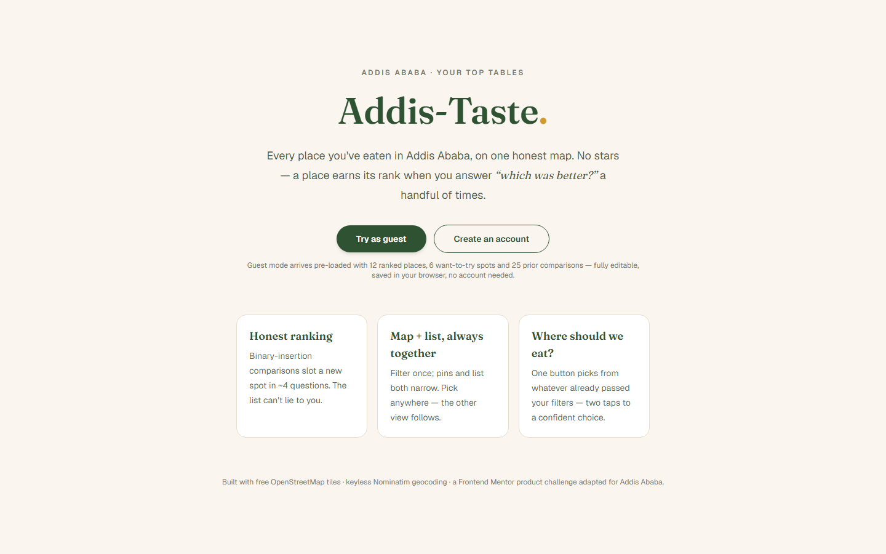
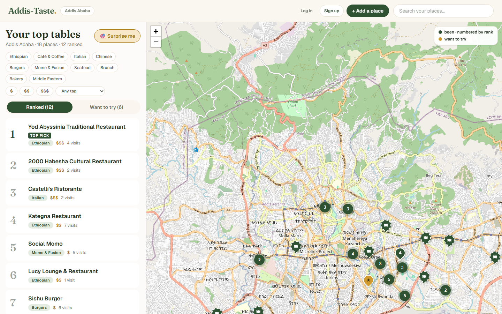
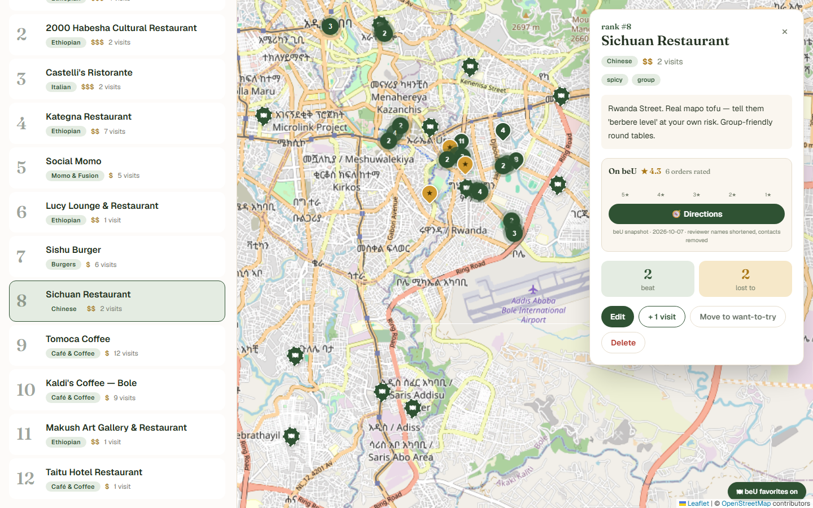
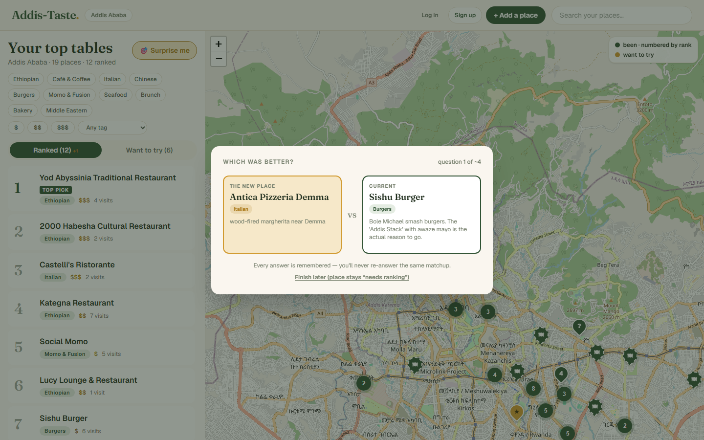
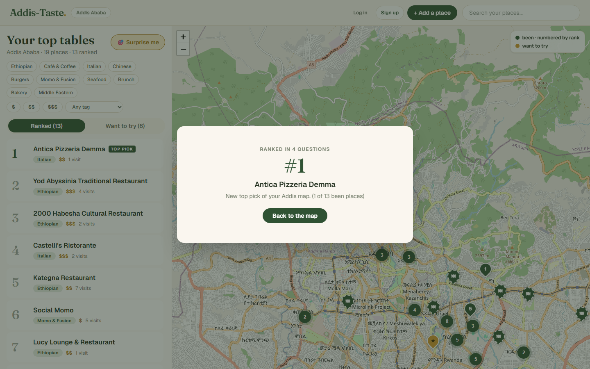
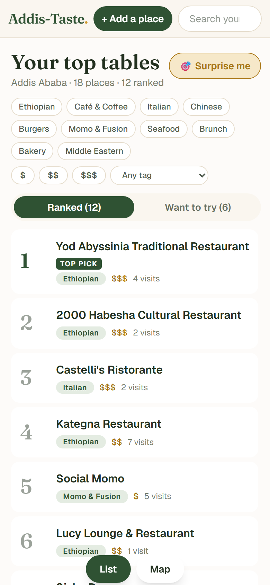
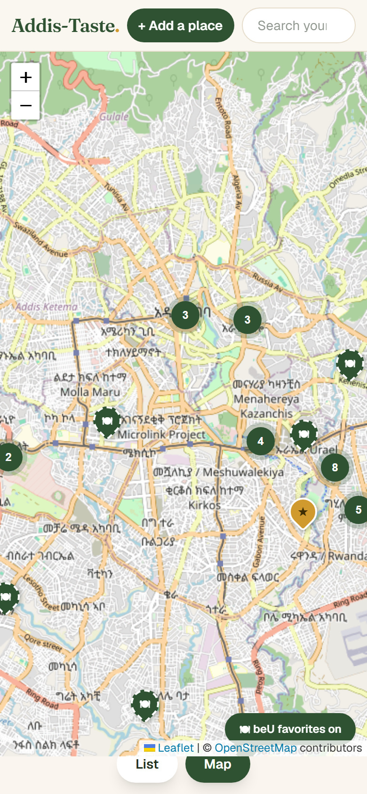

# Addis-Taste — Addis Ababa

A restaurant map and ranking app for Addis Ababa, Ethiopia. Log the places you've eaten, rank them through quick head-to-head comparisons ("which was better?"), keep a map of everything you still want to try — and now see how each place actually rates on [beU](https://beu.com.et) delivery.

This is my take on the [Frontend Mentor "restaurant ranking" challenge](https://www.frontendmentor.io), rebuilt for my own city instead of the London sample data. I reconstructed the brief from other builders' repos (details down in Credits) and wrote my own product spec, seed data, and design docs for Addis — they all live in [`docs/`](docs).

> [!NOTE]
> To see how chaotic a project like this really was, look at the [commit history](https://github.com/kidus-23/addis-taste/commits/main) — it spans a few months, from a half-finished ranking module to the finished app.

## Screenshots





**Place detail** (opened from either the list or the map) — with the beU enrichment when one exists:



**Head-to-head ranking** — every new "been" place slots in through a few quick questions:



And the verdict it eventually gives you:



**On a phone** — the list first, one tap for the map:

<p float="left">
  
  
</p>

## Why there are no stars

Everyone rates restaurants on a one-to-five scale, and it stops being meaningful around the third favorite. If all my usual kitfo spots get four stars, I've learned nothing about which one to actually go back to.

So I removed ratings. A place's rank comes out of little head-to-head questions — the app computes ⌈log₂(n+1)⌉ matchups via binary insertion, so each place lands in the list after roughly a handful of them. The exact code path is `deriveRankedOrder` / `nextComparison` / `settleSlot` in [`src/lib/ranking.ts`](src/lib/ranking.ts) and, honestly, that file is the heart of the app.

If you *want* stars, the map has them — they just come from other people. See the next section.

## beU-powered map cards

beU is Addis Ababa's homegrown food-delivery platform, so it carries exactly the signal my seed list lacks: how a place holds up when it's ordered from, across hundreds of real customers.

Toggling **🍽 beU favorites** (bottom-right of the map) overlays the top-40 most-ordered venues from my snapshot as dashed pins. Tapping one opens a small pop-out card: star average, order count, one attributed reviewer quote, and a 🧭 Directions link (Google Maps, resolving the actual venue — never bare coordinates). "⌄ More" expands the card in place into the five-star histogram and up to three quotes.

Where a beU venue is unambiguously one of my own ranked places (matching runs on distinctive-name-token similarity, so "Sishu Burger" never attaches itself to just any burger joint), the reward is richer:

- the **detail sheet** gains an "On beU" block — average, histogram, top quotes, directions;
- the card itself links straight into that detail sheet.

The data is a **one-time snapshot** (`retrieved 2026-10-07`, `src/data/beu-snapshot.json`), not a live proxy: nothing in the app talks to beU's API at runtime, and there's no rate limit to hit or outage to leak. The import script that produced it (`scripts/import-beu.mjs`, rerunnable) strips every identity field except reviewer **first name**, keeps text/rating/what-they-ate, and its selftest proves it — no phones, emails or tokens ever reach the repo (`scripts/verify-beu.ts` re-checks the snapshot on demand).

## How it was built

I started this in May 2026 as a stack of notes and a hand-drawn sketch of a ranked list, mostly to answer one question I kept arguing about with myself: "do ratings work when the thing being rated is food you re-visit?" Short version — they don't. So Addis-Taste's whole premise became: never ask for a score, ask for comparisons between things you've already been to.

The first thing I actually got working was the pure ranking module — no UI, just TypeScript in `src/lib/ranking.ts`, with a script that derived an order from a fake pile of matchups and printed it. Once that could place a new venue in the right slot, everything else was scaffolding around it.

A few decisions worth explaining, since they cost me the most time:

- **The ranking is derivation-only.** There's no `position` you can argue with in the UI — the server recomputes it from the stored comparison graph every time. When two places are perfectly even in the graph, the most recent result between them stands, and the list just says so ("tied — settle it with a new answer"). That trade-off showed up in `docs/design-challenges.md` before I wrote a line of UI.
- **Guest mode comes first.** Every "what if" feature check on a half-built app is painful if you need a database running. The Addis Ababa seed (12 ranked been places, 6 want-to-try, 25 prior matchups — real venues, my own picks) lives in `src/data/addis-seed.ts`, loads straight into a Zustand store with localStorage, and never talks to the DB. That's also why the demo is useful: you open the app and it's an *interesting* app, not an empty one.
- **The beU data is a snapshot, not a proxy.** First attempt at the matcher over-matched wildly — 41 venues proudly "seed-matched" because "burger" is in everyone's name. The matcher now scores *distinctive* tokens only (branch names like "Bole"/"|22| Piassa" stripped, generic food words stoplisted), live matching runs in `src/lib/beu.ts` with the exact same rules the importer used, and the snapshot captures only venues with real order volume behind their ratings (seed-matches exempt — Tomoca has one beU order and it's shown, honestly labeled).
- **No frills on map/geocoding.** Leaflet + OpenStreetMap tiles + leaflet.markercluster, all keyless. Geocoding goes through Nominatim proxied by one small API route (`src/app/api/geocode`) so we control the User-Agent it's sent with (the usage policy requires it), with a manual "drop the pin" fallback when the street address isn't in OSM. There's no API key anywhere in the repo because it's nowhere in the app.
- **Auth is boring on purpose.** `jose` + bcryptjs, one httpOnly cookie, JS routes for signup/login/logout and an `/api/places` + `/api/compare` pair. Same ranking math runs server-side in `src/lib/place-service.ts` — a good check that `ranking.ts` really was framework-free.
- **The boring harden-at-the-edging pass ships too.** `next.config.ts` sets a pragmatic CSP (no nonces, but tiles/fonts/connection pinned), `X-Content-Type-Options`, `X-Frame-Options: DENY` and `Referrer-Policy`; `src/proxy.ts` rate-limits login/signup to 10 attempts per 5 minutes per IP (Next 16 renamed middleware to proxy).

### Bugs I had to fix (all hindsight lessons)

- The "settled!" modal used to close itself the same tick the flow ended, so you never saw the rank — settle and dialog-close were one state update. Now the dialog owns its close button; settling only switches its content.
- "The list has spoken" for a bottom-ranked place never fired — the code compared the rank against the *question count* (≈5) rather than the list length.
- Editing one place brought another place's values — the dialog mount persists, stale `useState` initializers.
- Pin highlight always dropped after the markers got rebuilt (a build races the highlight style) — now the rebuild reads the live selection from a ref.
- Phone map tab was grey when the map initializes hidden in `display:none` → `map.invalidateSize()` from a ResizeObserver when it appears.
- Top bar overflow on ≤360 px when both auth buttons and the search field render — the search drops to its second row below sm.
- The map used to boot inside the dashboard's zero-height "initializing" state — Leaflet built its whole tile lattice collapsed and never recovered. It now waits for a real layout before creating the map, and a ResizeObserver feeds it `invalidateSize` ever after.
- The list showed the *stored* position, which only the just-settled place ever gets — so when a new place took #1, the old #1 also kept showing "1". All ranks (list, pin labels, detail sheet) now come straight from the derived head-to-head order.
- The beU pop-out card closed itself the moment you tapped "⌄ More": it floats inside the Leaflet container, so the tap bubbled to the map's own click-to-close. `L.DomEvent.disableClickPropagation` on the card fixed it — the classic cost of embedding your own overlay in someone else's widget.

Every change is pinned down headlessly with `npm run verify` (two scripts: ranking invariants and guest-flow semantics). If something UI-side could go wrong in a session, the verify scripts cover where it came from. The beU layer has its own gate: `npx tsx scripts/verify-beu.ts` (data integrity, PII scrub, directions URLs, matching).

### Two features of my own (from the challenge brief's open decisions)

1. **"Where should we eat?"** — the "Surprise me" button on the dashboard. Filters already narrow to what you want (want-to-try, price range, cuisine, tag), the button picks one out of the eligible set, does a short shuffle, centers the map and opens its detail page, so the decision takes two taps.
2. **One shared selection state.** Select a pin or a list card and both follow: surfacing detail opens, the map centers in on the place, its pin glows. Map and list never disagree about what you're looking at.

Both are written up in [`docs/design-challenges.md`](docs/design-challenges.md) with the alternatives I rejected.

## Tech stack

| Layer      | Choice                                                     |
| ---------- | ---------------------------------------------------------- |
| Framework  | Next.js 16 (App Router) + TypeScript + React 19            |
| Styling    | Tailwind CSS v4                                            |
| Database   | PostgreSQL (Docker Compose for local dev, any DATABASE_URL for prod) |
| ORM        | Prisma 7 + `@prisma/adapter-pg`                            |
| Auth       | Custom JWT sessions (`jose`, httpOnly cookies, bcryptjs hashing) |
| Map        | Leaflet + leaflet.markercluster, OpenStreetMap tiles (keyless) |
| Geocoding  | Nominatim (keyless, a proper User-Agent, manual pin-drop fallback) |
| Delivery data | One-time beU snapshot (`scripts/import-beu.mjs` → `src/data/beu-snapshot.json`), static-imported, PII-scrubbed |
| Guest mode | Fully client-side — Addis Ababa seed dataset in Zustand + localStorage, never touches the database |

## Run it yourself

```bash
git clone https://github.com/kidus-23/addis-taste.git
cd addis-taste
npm install
cp .env.example .env      # set DATABASE_URL (a Postgres 17+ instance)
docker compose up -d      # or your own Postgres
npm run db:push           # create the tables
npm run db:seed           # optional: demo account — demo@addistaste.et / addistaste-demo
npm run dev
```

Then open [http://localhost:3000](http://localhost:3000) and hit **Try as guest** — the full seed data loads with zero setup.

Before claiming anything works, I keep two gates:

- `npm run verify` — headless ranking + guest-flow checks (these catch the ranking math bugs before a browser does)
- `npx tsx scripts/verify-beu.ts` — snapshot integrity, PII scrub, directions-URL and matching checks

and then make sure `npm run build`, `npx tsc --noEmit` and `npm run lint` are all clean too. (`npm run build` also requires regenerating the Prisma client — `npm install` does — and the screenshots in this README come from `scripts/screenshot.cjs`, run against `npm run start` with the DB up.)

## What's in the repo

```
├── docs/
│   ├── product-definition.md     # the product took shape while writing this
│   ├── core-requirements.md      # features + their acceptance criteria
│   ├── design-challenges.md      # rationale for the 3 "design it yourself" calls
│   ├── technical-requirements.md
│   ├── screenshots/              # the images above, regenerated by scripts/screenshot.cjs
│   └── data/                     # the Addis seed data as CSV, its derivation
├── prisma/                       # schema + demo-account seed
├── src/
│   ├── app/                      # Next routes: landing, dashboard, API handlers
│   ├── components/               # Leaflet panel, list cards, detail sheet, dialogs…
│   ├── lib/                      # ranking.ts, beu.ts, store, auth, server actions
│   ├── proxy.ts                  # login/signup rate limiting
│   ├── data/addis-seed.ts        # guest dataset: 18 places + 25 matchups
│   └── data/beu-snapshot.json    # PII-scrubbed beU snapshot (retrieved 2026-10-07)
├── scripts/                      # verify scripts + beU importer + screenshot generator
└── docker-compose.yml            # local Postgres
```

## Data provenance

The seed dataset is real places — Yod Abyssinia, 2000 Habesha, Castelli's, Tomoca, Kaldi's, Sishu Burger, Social Momo, Sichuan, Lucy Lounge, Makush, Kategna, Taitu Hotel and a few more — with coordinates out to neighborhood level (Bole, Kazanchis, Piassa, Old Airport, Gerji, Sarbet). Where I got it and how each prior matchup was chosen: [`docs/data/README.md`](docs/data/README.md). The CSV in there regenerates straight from `src/data/addis-seed.ts`, so the seed stays one source of truth.

The beU layer has its own provenance: it's a one-time capture of beU's Addis Ababa catalog (their public developer API, zone 1), taken 2026-10-07 by `scripts/import-beu.mjs` — 42 venues in the snapshot: the top ~40 by order-weighted volume plus 2 seed matches. Only first names, dates, ratings, dishes and review text survive the import; everything identifying anyone is dropped before the JSON is ever written. **I am not affiliated with beU**; the data is theirs and used here for a personal, non-commercial demo. Say hi to their app instead — it delivers.

## Credits

- [Frontend Mentor](https://www.frontendmentor.io) challenge — restaurant ranking app. (`Mduduzi-Ndlovu1/tastemap` and `suman-hazra/tastemapsf`'s write-ups were my main cues for reconstructing the brief — thanks.)
- Map tiles © [OpenStreetMap](https://www.openstreetmap.org/copyright) contributors.
- Geocoding by [Nominatim](https://operations.osmfoundation.org/policies/nominatim/) — used sparingly per their usage policy.
- beU delivery data: one-time snapshot of their Addis Ababa catalog; reviewer identities stripped to first names at import.
- Agent-rules files (`AGENTS.md`/`CLAUDE.md`) were removed from the repo — LLM-builder scaffolding, not product.
- Addis Ababa seed data is invented. Places are real; the opinions are mine.
